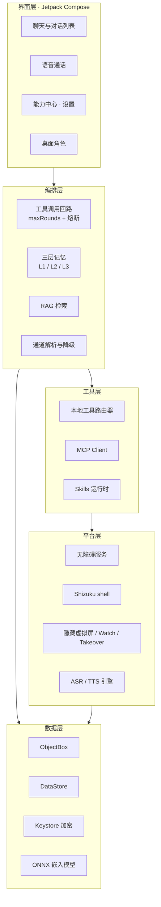

# Prism

<p align="center">
  <a href="LICENSE"></a>
  
  
  
  
  
</p>

> 手机上的个人 AI Agent —— 会聊天、会记事、会用工具，还能替你操作手机。

Prism 是一款 **Android 原生、零后端**的个人 Agent 应用。它不只是一个聊天框：LLM 在这里可以调用工具、检索你自己的知识库、跨会话记住你、把回复读成语音、驱动桌面上的角色形象，甚至在后台替你操作其它 App。

所有数据留在设备上——没有 Prism 账号，没有中转服务器，只有你和你自己配置的模型端点。

## 为什么是 Prism

| | 普通 AI 聊天 App | Prism |
|---|---|---|
| 模型端点 | 平台指定 | **BYOK**：任意 OpenAI 兼容 / Anthropic / Ollama 端点 |
| 数据 | 过平台服务器 | **零后端**：Key 与对话都在设备侧，Keystore 加密 |
| 能力边界 | 只会说话 | **会做事**：内置工具、MCP、Skills、手机操控 |
| 记忆 | 单会话上下文 | **三层记忆** + 端侧 RAG 知识库 |
| 存在感 | 只有气泡 | **语音通话** + **桌面角色**（Live2D） |

## 核心能力

| 领域 | 能做什么 |
|---|---|
| 💬 对话 | 流式输出、深度思考、思维链折叠、对话回退、重新生成与多版本切换 |
| 🧠 记忆 | L1 滑动窗口 + LLM 摘要、L2 跨会话向量记忆、L3 显式与隐式用户画像 |
| 📚 知识库 | 端侧 RAG：PDF/DOCX/XLSX/MD/TXT → 切片 → ONNX 嵌入 → 向量检索 + 引用来源 |
| 🔧 工具 | 内置工具路由器、MCP Client、SKILL.md 技能包、`ask_user` 主动提问 |
| 🌐 联网 | Bing RSS 搜索（零 Key）、WebView 渲染抓取、中文平台热榜 |
| 📄 文档 | Markdown → Word / Excel 生成，文件系统读写 |
| 🎙 语音 | 语音通话（流式 ASR + TTS）、端侧音色克隆、角色音色绑定 |
| 📱 手机操控 | 无障碍 + Shizuku，隐藏虚拟屏后台执行、Watch 观战、Takeover 接管 |
| 💌 QQ 小号助手 | 双轨通道（OneBot / 无障碍）、后台代发、自动回复、随机定时主动消息 |
| 🐾 角色与桌宠 | 角色包（人设 / 世界书 / 音色）、Live2D 桌面挂件、动作与口型联动 |

## 功能详解

### 💬 对话与模型

- **BYOK 多端点**：OpenAI 兼容（DeepSeek / Moonshot / OpenRouter …）、Anthropic 原生、Ollama 本地模型；会话中可切换 Provider 并保留历史
- **深度思考**：按端点能力发送 `thinking` / `reasoning_effort`（low / high / max），推理过程以可折叠卡片呈现；不兼容端点会明确提示
- **对话回退**：从任意用户消息回滚，可选是否先保存当前副本
- **重新生成**：重试产生多个变体，随时左右切换，不丢失旧版本
- **流式渲染**：SSE 增量输出，工具调用与文本交错的回合式渲染
- **待办清单**：`todo_write` 让 Agent 自建多步计划并在界面上打勾推进

### 🧠 记忆与知识

三层记忆解决"越聊越糊"：

- **L1 滑动窗口**：最近 N 轮原文 + 超窗时 LLM 摘要压缩后回注
- **L2 跨会话记忆**：会话结束向量化入库，新会话按相关度召回
- **L3 用户画像**：显式（设置里填的偏好）+ 隐式（从对话中抽取的偏好）

任一层的失败都降级为 `null` 而不阻断对话——记忆是增强，不是前提。

端侧 RAG 知识库支持分库管理（如「工作」/「学习」），导入即解析→切片→嵌入→可检索，回答标注文件名与片段位置。

### 🔧 工具生态

工具通过统一路由器装配，命名空间前缀区分来源：

| 命名空间 | 作用 |
|---|---|
| `phone_control__` | 手机操控（12 个工具：读屏 / 点击 / 长按 / 双击 / 滑动 / 输入 / 返回 / 桌面 / 启动应用 / 等待 / 截图 / 人工接管） |
| `qq__` | QQ 小号助手（发消息 / 发语音 / 改签名 / 定时消息管理） |
| `knowledge_base__` | 知识库检索 |
| `web_search__` | 联网搜索 |
| `hotlist__` | 中文平台实时热榜 |
| `document__` | Word / Excel 生成 |
| `cross_app__` | Deep Link 跳转与系统分享 |
| `todo__` | 待办清单 |
| `pet__` | 桌宠动作与表情 |
| `ask_user__` | 反向提问，需要用户决策时主动发问 |
| `mcp_*` | MCP Server 提供的远程工具 |

- **MCP Client**：内置本地 Server（文件系统、网页抓取、记忆、时序推理、时间等）与多个远程模板（GitHub / Notion / Slack / Sentry / Stripe / Asana / Brave / Exa / Context7），也支持自定义远程 Server
- **Skills**：兼容 `SKILL.md` 声明式工具包，支持本地与 HTTPS 远程加载（多重校验 + zip slip 防护），仅在启用时加载，不污染系统提示词
- **工具权限**：每次工具调用可按策略确认或自动批准；支付 / 密码 / 验证码等敏感内容由拦截器硬拦截，不可绕过

### 🎙 语音

- **语音通话**：全双工会话式交互，悬浮通话层 + 前台服务保活
- **ASR 三档**：端侧流式（sherpa-onnx）→ 云端流式（阿里云 Paraformer-realtime）→ 系统识别降级
- **TTS 多引擎**：系统 TTS（零依赖）→ 云端 MiniMax → **端侧音色克隆**
- **音色克隆**：侧载或应用内导入 `.voicepack`，本地合成、流式播放，支持段间停顿与总静音上界，避免长文本播报出现大段空白
- **角色音色**：角色包可声明音色，用户选择优先于角色包声明

### 📱 手机操控

让 LLM 真正"用手"操作手机，三种执行面：

| 执行面 | 表现 | 依赖 |
|---|---|---|
| 前台 | 直接操作当前屏幕，支持坐标手势 | 无障碍服务 |
| 隐藏虚拟屏 | 在不可见副屏运行目标 App，**主屏不受影响** | Shizuku |
| Takeover | 把后台任务迁移到主屏，用户可旁观 | Shizuku |

- **无障碍读取**：UI 树结构化文本；树不可读时（微信 / WebView / Flutter）自动回退到截图 + OCR 文字与图标区域
- **Shizuku 增强**：shell 身份直启应用到副屏、坐标手势、跨用户（工作资料 / 分身）启动
- **Watch 观战**：可选主屏小窗实时观看 Agent 在后台的操作画面
- **自愈与对账**：虚拟屏残留、孤儿 shell 进程、被系统清掉的无障碍注册都会在启动时检测并恢复，失败如实报告
- **安全边界**：敏感页硬拦截、高优先级人工接管、用完即回收目标 App，不在主屏留下残影

### 💌 QQ 小号助手

在端侧控制一个小号，让 Agent 以"你"的身份与之对话——不需要服务器，也不上传聊天记录。

- **双轨通道**：优先 OneBot 11 协议端（需自建 NapCat 等），未连接时自动降级为无障碍 UI 自动化；切换由能力探测驱动，不是配置项决定
- **后台代发**：经隐藏虚拟屏以小号身份发送，主屏无感
- **双向自动回复**：检测新消息 → 读取上下文 → LLM 生成 → 后台发出；被动应答与主动消息的配额分离，用户说话必答、系统不主动打扰
- **随机定时主动消息**：活跃时段（HH:mm，支持跨零点）+ 每日上限 + 最小间隔，泊松或均匀采样，精确闹钟兜底
- **失败分型**：环境类（熄屏 / 执行面 / 通道）不计熔断，账号态（需重新验证）不重试不占配额，避免空转烧额度
- **隐私**：消息内容只在设备与你的模型端点之间流动

> 该能力涉及第三方 App 的自动化操作，请遵守目标平台的服务条款，仅用于你自己的账号。

### 🐾 角色包与桌宠

角色是**可导入的资产包**，而不是写死在应用里的预设：

- **RolePack**（`prism-rolepack/1`）：persona / worldbook（关键词激活的背景设定）/ style / voice / pet
- 导入到应用私有目录，随卸载清除，不入 APK、不入公开仓库；出厂仅内置一个中性助手
- **桌宠**：Live2D 渲染（WebView + pixi.js + Cubism Core），支持动作、表情、物理摆动、命中区点击、眨眼呼吸与口型同步
- **AI 联动**：`pet__play_action` 工具让角色配合说话内容做动作，回复以气泡显示在形象旁
- 默认关闭，显式开启；窗口可见、通知即入口、关闭即停服，无开机自启

> 形象资产请自行确认使用权。以示例角色为例，其 Live2D 模型作者为 B 站 UP 主 [是依七哒](https://space.bilibili.com/457683484)，角色 IP 属米哈游 / HoYoverse 且禁止商用。

### ⚙️ 设备适配

按 RAM 自动分档，也可手动覆盖（重启生效）：

| 档位 | 内存 | 知识库 | 跨会话记忆 | 嵌入模型 | top-k |
|---|---|---|---|---|---|
| FULL | ≥ 6 GB | 标准批次 | 启用 | 常驻，闲置 5 min 卸载 | 5 |
| STANDARD | 4–6 GB | 小批次 | 启用 | 按需，闲置 2 min 卸载 | 3 |
| MINIMAL | 3–4 GB | 关键词检索 | 禁用 | 不加载 | — |
| CHAT_ONLY | < 3 GB | 禁用 | 禁用 | 不加载 | — |

## 快速开始

### 环境要求

- Android Studio，需支持 AGP 8.13（Narwhal 或更新版本）
- JDK 17
- Android SDK 34
- 真机 **Android 8.0+（API 26+）**，arm64

### 构建

```bash
git clone git@github.com:ljhthink/Prism.git
cd Prism
./gradlew :app:assembleDebug
```

产物：`app/build/outputs/apk/debug/app-debug.apk`

### 安装

```bash
adb install -r app/build/outputs/apk/debug/app-debug.apk
```

### 首次配置

1. 打开 **设置 → 模型与端点 → Provider 配置**，添加一个端点（名称 / baseURL / 模型名）
2. 在 **API Key** 填入密钥（Keystore 加密，明文不落盘）
3. 回到聊天页即可开始；联网搜索、深度思考可在输入框上方或设置页随时切换

### 可选增强

以下能力按需开启，不开启时应用功能完整、只是少了对应能力：

| 能力 | 需要 | 开启位置 |
|---|---|---|
| 读屏与点击 | 无障碍服务 | 设置 → 手机操控 |
| 后台执行面 / 坐标手势 | [Shizuku](https://shizuku.rikka.app/) | 设置 → 手机操控 → Shizuku |
| Watch 观战小窗 | 悬浮窗权限 | 设置 → 手机操控 → 观看 AI 操作 |
| 语音通话 | 麦克风 + 通知 | 设置 → 语音通话 |
| 定时主动消息 | 精确闹钟 | 设置 → QQ 小号助手 |
| 桌宠 | 悬浮窗 + 前台服务 | 设置 → 桌宠 |

## 架构



源码地图（`app/src/main/java/io/prism/`）：

| 目录 | 职责 |
|---|---|
| `ui/` | Compose 界面：聊天、对话列表、能力中心、知识库、设置、主题 |
| `network/` | Provider 抽象与流式请求、MCP Client、搜索与抓取、本地工具执行器 |
| `skill/` | 工具回路、工具路由、SKILL.md 解析与下载、待办与反向提问 |
| `phonecontrol/` | 无障碍服务、Shizuku 用户服务、显示后端、执行面与保活 |
| `qq/` | QQ 小号助手：通道抽象、调度、守卫、失败分型、状态仓库 |
| `voice/` | 语音会话、ASR / TTS 引擎、端侧音色克隆（`local/`）、云端引擎（`cloud/`） |
| `pet/` | 角色包桌宠：形象资产、悬浮窗、渲染描述符、动作工具 |
| `memory/` `rag/` `embedding/` `ingestion/` | 三层记忆、检索编排、ONNX 嵌入、文档摄入 |
| `document/` `hotlist/` `crossapp/` `fs/` | 文档生成、热榜、跨 App、文件系统工具 |
| `data/` `config/` `security/` `tier/` | 持久化、配置仓库、Keystore 封装、设备分档 |
| `app/src/sherpa/kotlin/` | sherpa-onnx 条件源集（AAR 就位才编译，含端侧 ASR 与 VITS） |
| `assets/pet/` | 桌宠渲染器（HTML / JS + 内置 pixi 与 Cubism 运行时） |

## 技术栈

| 领域 | 选型 |
|---|---|
| 语言 | Kotlin 2.3 |
| UI | Jetpack Compose + Material 3 |
| 数据库 | ObjectBox 5.4 |
| 网络 | Ktor 3.3（OkHttp 引擎） |
| 序列化 | kotlinx.serialization 1.11 |
| MCP | MCP Kotlin SDK 0.12 |
| 嵌入 | ONNX Runtime 1.27 + all-MiniLM-L6-v2 INT8 |
| 文档解析 | Apache PDFBox 3.0 + POI 5.5 |
| 安全 | Android Keystore + Tink 1.15 |
| 权限增强 | Shizuku API 13.1 |
| 构建 | Gradle 8.13 + AGP 8.13 |
| SDK | min 26 · target / compile 34 |

## 隐私与安全

**零后端**：Prism 自身不运营任何服务器。模型请求直连你配置的端点；没有账号体系，没有遥测上传。

- **密钥**：API Key 经 Android Keystore 加密后存入 DataStore，明文不落盘、不进日志
- **数据**：对话、记忆、知识库、音色包、角色包全部位于应用私有目录，随卸载清除
- **日志**：敏感内容（正文、联系人、账号、密钥）在日志中脱敏或截断
- **资产**：角色形象、音色包、训练素材始终是用户私有资产，不提交版本库、不打进 APK

申请的系统权限与用途：

| 权限 | 用途 |
|---|---|
| `INTERNET` / `ACCESS_NETWORK_STATE` | 访问你配置的模型端点、搜索与 MCP |
| `RECORD_AUDIO` + `FOREGROUND_SERVICE_MICROPHONE` | 语音通话 |
| `FOREGROUND_SERVICE(_SPECIAL_USE)` | 语音通话、定时消息、桌宠的前台保活 |
| `POST_NOTIFICATIONS` | 状态与提醒通知 |
| `SYSTEM_ALERT_WINDOW` | Watch 观战小窗、桌宠 |
| `SCHEDULE_EXACT_ALARM` | 定时主动消息的精确触发 |
| `WAKE_LOCK` | 后台执行任务期间保持唤醒 |
| `KILL_BACKGROUND_PROCESSES` | 无 Shizuku 时回收后台执行目标 |

无障碍服务与 Shizuku 属**可选**增强，只在你显式开启后参与；不开启时应用不会读取屏幕。

## 工程质量

本项目以"先取证、再修改、后验收"的方式推进，每次改动都走同一条闭环：

```text
方案 → 影响自检 → guardrail 审查（可多轮）→ 单元 / 真机验收 → 真机手动确认
```

当前基线：

| 项 | 数值 |
|---|---|
| 单元测试 | 260 个套件 / 3572 用例（最近一次全量） |
| 静态检查 | lint 0 error |
| 最低验证设备 | Android 16 真机（HyperOS） |

文档质量由 CI 把关：Markdown 规范检查、文档索引一致性校验、本地链接检查。

## 文档

| 文档 | 内容 |
|---|---|
| [docs/progress.md](docs/progress.md) | 项目进展记录（唯一进展事实来源） |
| [docs/PRD.md](docs/PRD.md) | 产品需求基线 |
| [docs/decisions/](docs/decisions/README.md) | 架构决策记录（ADR 索引） |
| [docs/reports/](docs/reports/README.md) | 一次性调研 / 审查 / 验收报告归档 |
| [docs/templates/](docs/templates/README.md) | PRD / ADR / 报告模板 |
| [docs/design/deep-space-glass-design-spec.md](docs/design/deep-space-glass-design-spec.md) | 视觉设计规范 |
| [docs/behavioral-rules.md](docs/behavioral-rules.md) | 行为规则累积层 |

按功能分域的 PRD：

- [docs/prd-v1-features.md](docs/prd-v1-features.md) —— 基础能力集
- [docs/prd-search-fetch-enhancement.md](docs/prd-search-fetch-enhancement.md) —— 搜索与抓取增强
- [docs/prd-mcp-api-enhancement.md](docs/prd-mcp-api-enhancement.md) —— MCP 能力扩展
- [docs/prd-v1-b20-voice-bg-control.md](docs/prd-v1-b20-voice-bg-control.md) —— 语音通话与手机操控
- [docs/prd-v1-b21-shizuku-bg-control.md](docs/prd-v1-b21-shizuku-bg-control.md) —— Shizuku 后台化
- [docs/prd-local-voice-clone.md](docs/prd-local-voice-clone.md) —— 端侧音色克隆
- [docs/prd-v1-b24-rolepack-pet.md](docs/prd-v1-b24-rolepack-pet.md) —— 角色包与桌宠
- [docs/prd-qq-burner-account.md](docs/prd-qq-burner-account.md) —— QQ 小号助手

运维手册：

- [docs/runbooks/setup-local-voice-clone.md](docs/runbooks/setup-local-voice-clone.md) —— 音色包侧载与启用
- [docs/runbooks/searxng-selfhost.md](docs/runbooks/searxng-selfhost.md) —— 自建 SearXNG 搜索
- [docs/runbooks/miui-logcat-real-device.md](docs/runbooks/miui-logcat-real-device.md) —— 真机日志抓取

AI 协作规则位于 [AGENTS.md](AGENTS.md)（入口）与 `rules/` 模块，规则文件与进展记录为本地专属、不推送到远程。

## 参与贡献

欢迎 Issue 与 PR：

1. Fork 并基于 `main` 开分支
2. 保持改动聚焦，附带测试或真机证据
3. 运行 `./gradlew :app:testDebugUnitTest :app:lintDebug` 保证本地绿灯
4. 若新增或重命名文档，请同步更新 [docs/progress.md](docs/progress.md) 与文档索引

提交信息建议遵循 `type(scope): 摘要` 形式（如 `fix(qq): …`），并在正文说明取证与验证方式。

## 许可证与致谢

基于 [Apache License 2.0](LICENSE) 开源，第三方组件署名见 [NOTICE](NOTICE)。

特别致谢：

- [Shizuku](https://shizuku.rikka.app/) —— 提供免 root 的 shell 能力通道
- [OpenCyvis](https://github.com/opencyvis/opencyvis-phone) —— 隐藏虚拟显示方案的参考实现
- [pixi.js](https://pixijs.com/) / [pixi-live2d-display](https://github.com/guansss/pixi-live2d-display) / [Live2D Cubism](https://www.live2d.com/) —— 桌宠渲染栈
- [sherpa-onnx](https://github.com/k2-fsa/sherpa-onnx) / [ONNX Runtime](https://onnxruntime.ai/) —— 端侧语音与嵌入推理

> 本项目仅供个人学习与自用。使用手机操控、QQ 小号助手等能力时，请自行确认是否符合目标平台的服务条款与当地法律法规。
